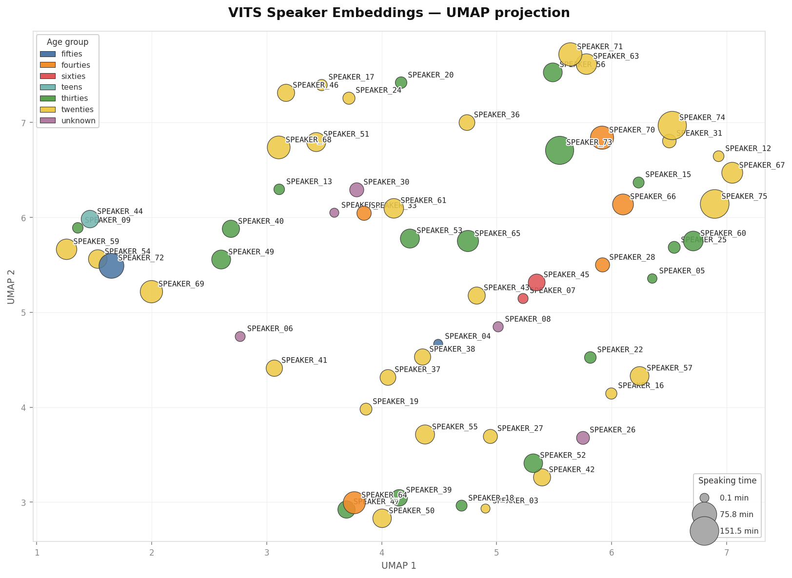

# tts-puno-quechua

Text-to-speech models for Puno Quechua (qxp) using Mozilla Common Voice data (Scripted Speech 26.0).

We used the VITS architecture implemented by [Coqui TTS](https://github.com/coqui-ai/TTS) to train two models, one using female voices and the other using male voices.

## Female voices
The model for female voices is trained on 62 voices (23 hours of data - 17,547 clips).
It can generate speech in **4 anonymised voices** (see the demo directory to listen to an example of each voice).



## Downloading the models
The model weights are stored with Git LFS.
Run `git lfs install` before cloning the repo.

## Run inference

1) Install Coqui-TTS from the requirements.txt file (tested with Python 3.11)
```
python -m venv tts-env
source tts-env/bin/activate
pip install -r requirements_tts.txt
```
2) Download the model with the config.json (female_model or male_model directory)
3) Run inference with provided script:
```
python run_inference.py female_model --checkpoint female_model.pth --text "Kunanqa nuqapis qichwata rimaniña." --output demo.wav
```

## Baseline

A baseline for the (non-linguistic) sound quality of TTS-generated audio was calculated using [NISQA](https://github.com/gabrielmittag/NISQA). Details of the scores are available in the evaluations directory.
The average is
- 3.8 for female voices
- 4.5 for the male model
